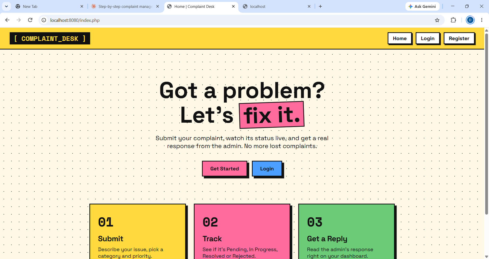

# Complaint Desk: Online Complaint Management System

A web app where users submit complaints, track their status, and read admin responses. Built for colleges, apartments and companies.

**Tech stack:** HTML, CSS, JavaScript, PHP, MySQL, Docker
**UI style:** Neo-brutalism (thick borders, hard shadows, flat bright colors)

## Screenshots



## Features

**Users**
- Register and login (passwords are hashed)
- Submit complaints with category and priority
- Track status: Pending, In Progress, Resolved, Rejected
- Read the admin's response

**Admin**
- Dashboard with complaint counts
- Search and filter by status and category
- High-priority complaints shown first
- Change status and reply to users

## Run with Docker

1. Install [Docker Desktop](https://www.docker.com/products/docker-desktop/).
2. Clone the repo and start it:

```bash
git clone https://github.com/Dushyanth-2806/complaint-management-system.git
cd complaint-management-system
docker compose up --build
```

3. Open http://localhost:8080
4. Register an account on the site, then make it an admin (use your own email):

```bash
docker compose exec db mysql -uroot -prootpass complaint_db -e "UPDATE users SET role='admin' WHERE email='you@example.com';"
```

5. Log out and log in again. The **Admin Panel** link appears in the navbar.

To stop: press `Ctrl + C`, or run `docker compose down`.
To reset the database: `docker compose down -v`, then start again.

> The password `rootpass` is only for the local Docker database. Use a strong, private password if you ever deploy this online.

## Security

- Prepared statements on every query (SQL injection protection)
- `password_hash` / `password_verify` for passwords
- Output escaped with `htmlspecialchars` (XSS protection)
- Role checks on user and admin pages
- Session ID regenerated on login

## Project structure

| File | Purpose |
|---|---|
| `Dockerfile`, `docker-compose.yml` | PHP + Apache and MySQL containers |
| `database.sql` | Creates the database and tables |
| `config.php` | DB connection, session, helper functions, category list |
| `includes/header.php`, `footer.php` | Shared navbar and footer |
| `index.php` | Home page |
| `register.php`, `login.php`, `logout.php` | Authentication |
| `submit_complaint.php` | New complaint form |
| `dashboard.php` | User's complaints and status counts |
| `view_complaint.php` | One complaint with the admin reply |
| `admin/dashboard.php` | Admin list, stats, filters, search |
| `admin/respond.php` | Admin changes status and writes a reply |
| `assets/css/style.css` | The whole design |
| `assets/js/script.js` | Validation, character counter, confirm popup |

## Run with XAMPP instead

1. Copy the folder to `C:\xampp\htdocs\complaint-system\`
2. In `config.php`, set `$host = "localhost"` and `$pass = ""`
3. Import `database.sql` in phpMyAdmin
4. Open http://localhost/complaint-system/

## Future ideas

- Email notification when the status changes
- File or image attachments
- Pagination on the admin table
- Password reset